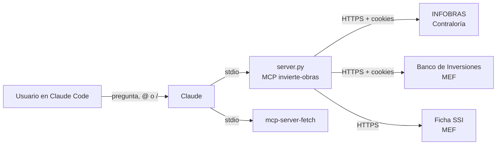

# Cómo se construyó el MCP `invierte-obras`

Este documento cuenta el proceso completo: de dónde salió la tarea, cómo se construyó y probó el servidor, qué
problemas aparecieron y cómo se resolvieron, qué prompts se usaron y con qué herramientas se trabajó. Los resultados
están en [`informe.md`](informe.md).

**Repositorio:** <https://github.com/IvettexMamani/Proyecto_Obras>
**Fecha:** 28 de octubre de 2026

---

## 1. El punto de partida

La tarea es el proyecto de la Sesión 04 del curso (*MCP en Claude Code*). Pide construir un servidor MCP en 100
minutos, en seis partes:

| Parte | Tiempo | Qué se pide |
|---|---|---|
| 0 · Preparar | 10 min | Copiar la carpeta, correr las pruebas, conectar el MCP de documentación |
| 1 · Servidor | 35 min | Completar el servidor hasta tener 8 de 8 pruebas en verde |
| 2 · Conectar | 10 min | `.mcp.json` con el servidor propio y `fetch`; probar una herramienta, un `@` y un `/` |
| 3 · Evaluar | 25 min | Preguntas propias en `preguntas.csv` y `uv run evaluar.py`: memoria contra MCP |
| 4 · Informe | 15 min | `informe.md` con una figura y dos cifras verificadas a mano; push a GitHub |
| 5 · Margen | 5 min | Para lo que falle |

La plantilla del curso era un MCP del BCRP, pero el proyecto se hizo sobre un MCP propio de **inversiones y obras
públicas del Perú**, siguiendo las mismas seis partes y la misma rúbrica de 20 puntos:

| Criterio | Puntos | Qué se mira |
|---|---|---|
| Pruebas | 6 | 8 de 8 en verde |
| Herramienta propia | 3 | Útil, con un docstring que diga cuándo usarla y con su fuente en la respuesta |
| Recurso y prompt | 2 | Funcionan en Claude Code con `@` y con `/` |
| `.mcp.json` | 2 | En el repo, con el servidor propio y `fetch`, y sin claves |
| Evaluación | 4 | 10 preguntas, dos propias con la verdad revisada a mano (3); un experimento extra (1) |
| Informe | 3 | Qué acertó y qué no, por qué, una figura y dos cifras comprobadas en la web |

La primera versión de `server.py`, con cuatro herramientas, se escribió en una conversación anterior con Claude. Esta
etapa la completó, la probó y la evaluó.

---

## 2. Las fuentes de datos

El servidor consulta en vivo tres servicios públicos, sin claves ni CAPTCHA:

| Fuente | Qué aporta | Endpoints que usa el servidor |
|---|---|---|
| **INFOBRAS** (Contraloría) | Obras públicas y su estado: paralizada, en ejecución, finalizada | `Mapa/busqueda/obras/groupby/departamento`, `Mapa/busqueda/obras`, `Mapa/ListaParametrosComentario` |
| **Invierte.pe, Banco de Inversiones** (MEF) | Búsqueda de inversiones, costos y ejecución del año | `ConsultaPublica/traeListaProyectoConsultaAvanzada`, `general/traeListaDepartamento` |
| **Invierte.pe, ficha SSI** (MEF) | Ficha de seguimiento de un CUI, devengados y registro de obras paralizadas de la Ley 31589 | `Ssi/traeDetInvSSI`, `Dashboard/traeDevengSSI`, `paraliza/traeListaParalizaPublico` |

---

## 3. Qué tiene el servidor

`server.py` usa el SDK oficial de MCP para Python (`mcp` 2.3, clase `MCPServer`), `httpx` asíncrono y `truststore`.

| Tipo | Nombre | Para qué |
|---|---|---|
| Herramienta | `contar_obras_por_departamento(estado)` | Conteo de obras de INFOBRAS por departamento |
| Herramienta | `listar_obras_infobras(departamento, estado, pagina, por_pagina)` | Lista paginada de obras, con su CUI |
| Herramienta propia | `resumen_obras_departamento(departamento, estado)` | Recorre **todas** las páginas y devuelve totales, promedio, la obra de mayor monto y el reparto por provincia, entidad, modalidad y año. Las cuentas las hace Python, no el modelo |
| Herramienta | `buscar_inversiones(texto, departamento, situacion, costos...)` | Búsqueda en el Banco de Inversiones |
| Herramienta | `detalle_inversion(cui)` | Ficha SSI: costos (a) y total (a+b+c+d), devengados y Ley 31589 |
| Recurso (`@`) | `invierte://inversion/{cui}` | La ficha de una inversión como JSON |
| Recurso (`@`) | `infobras://paralizadas/por-departamento` | Conteo de obras paralizadas por departamento |
| Prompt (`/`) | `informe_obras(departamento)` | Informe de obras paralizadas que cruza INFOBRAS con Invierte.pe |

Cada respuesta trae `fuente` y `consultado` (fecha y hora de Lima), y las instrucciones del servidor le piden a Claude
que las cite siempre.

---

## 4. El proceso, parte por parte

### Parte 0 · Preparar

1. Se agregó `pytest` al proyecto: `uv add --dev pytest`.
2. Se escribió **`test_server.py`**, el contrato del servidor. Son 8 pruebas que llaman al servidor en memoria con el
   cliente del SDK (`Client(mcp)`), igual que lo haría Claude Code, y piden datos reales:

   | Prueba | Qué revisa |
   |---|---|
   | `test_contar_obras_paralizadas` | El total es la suma por departamento y trae la fuente |
   | `test_listar_obras_de_un_departamento` | El listado de Tacna cuadra con el conteo |
   | `test_buscar_inversiones` | La búsqueda «hospital» en Tacna encuentra el CUI 2341243 |
   | `test_detalle_inversion` | La ficha del CUI 2341243: nombre, monto viable, fecha de viabilidad, costos |
   | `test_errores_claros` | Un CUI inválido y un departamento inexistente dan errores que se entienden |
   | `test_resumen_sin_cuentas_a_mano` | La herramienta propia suma igual que el listado completo |
   | `test_un_recurso` | Existe `invierte://inversion/{cui}` y devuelve la ficha |
   | `test_un_prompt` | Existe `informe_obras` y menciona el departamento y la herramienta propia |

3. Primera corrida: **3 de 8 en verde**. Fallaban las tres piezas por construir (herramienta propia, recurso y
   prompt), además de dos errores reales que las pruebas destaparon (ver la sección 5).

### Parte 1 · Servidor

- Se corrigió el cliente HTTP, que fallaba con *"Event loop is closed"*: la clase `Sitio` ahora crea un cliente nuevo
  cuando cambia el *event loop*.
- `detalle_inversion` devuelve el CUI como texto, igual que `buscar_inversiones`.
- Se extrajo `_pagina_obras()` para que `listar_obras_infobras` y la herramienta propia compartan la paginación.
- Se agregaron `resumen_obras_departamento`, los dos recursos y el prompt `informe_obras`.
- Resultado: **8 de 8 en verde** (`uv run pytest -q`, unos 12 segundos).

### Parte 2 · Conectar

- `.mcp.json` quedó con dos servidores y sin claves:
  - **`invierte-obras`**: `uv run server.py`, con ruta relativa para que funcione al clonar el repo
  - **`fetch`**: `mcp-server-fetch`, lanzado con `uvx` y `truststore` (ver la sección 5)
- Se lanzaron ambos servidores por stdio, como lo hace Claude Code, y se probó una herramienta, un recurso y un prompt
  de cada uno.
- Con `claude -p` y Haiku se comprobó que **Claude elige la herramienta propia** para sumar montos, en vez de sumar a
  mano.
- El `@` y el `/` no se pueden probar con `claude -p`, porque el modo no interactivo no expande recursos ni prompts de
  MCP. Se probaron en la sesión interactiva: `/mcp__invierte-obras__informe_obras tacna` funcionó y produjo un informe
  completo.

### Parte 3 · Evaluar

1. **`preguntas.csv`**: 10 preguntas con una cifra oficial (`verdad`), una tolerancia y el link donde se comprueba:
   5 de INFOBRAS (conteos y un monto total) y 5 de fichas de Invierte.pe (costo, beneficiarios, devengado, monto
   viable, año de paralización).
2. Las verdades se sacaron con un **script aparte** que llama directo a las fuentes, sin pasar por `server.py`, para
   que la evaluación no sea circular. Dos se revisaron después a mano en la web (sección 6).
3. **`evaluar.py`**, adaptado del proyecto del curso, le hace cada pregunta a Claude Code con `claude -p` en varios
   modos y califica cada respuesta como *acierta*, *se equivoca* o *no sabe*:
   - `memoria`: sin herramientas.
   - `web`: con WebSearch y WebFetch.
   - `mcp`: solo con las herramientas de `invierte-obras`.
4. Corridas, con Claude Haiku:

   | Corrida | Memoria | Web | MCP |
   |---|---|---|---|
   | Base (`resultados_base.csv`) | 0 de 10 (10 «no sé»), 10.4 s | — | **10 de 10**, 16.1 s |
   | Experimento extra, `--modos memoria web mcp` (`resultados.csv`) | 0 de 10, 8.3 s | 0 de 10, 18.9 s | **10 de 10**, 13.0 s |

   Ningún modo inventó cifras. La web falló porque INFOBRAS y la ficha SSI cargan sus datos con JavaScript, así que
   WebFetch recibe la página vacía.
5. Se agregó `uv run evaluar.py --recalificar <csv>` para volver a calificar cuando cambia una verdad, sin volver a
   llamar a Claude.

### Parte 4 · Informe

- **`grafico.py`** genera `grafico.png` con dos paneles: los aciertos por modo y las obras paralizadas por
  departamento, sacadas de la herramienta del MCP. Antes de dibujar se cargó la guía de visualización `dataviz`. La
  primera versión tenía los títulos encimados y se corrigió al revisar la imagen.
- **`informe.md`** tiene la tabla de resultados, qué falló cada modo y por qué, la figura, las cifras comprobadas a
  mano y la conclusión.
- **Git y GitHub**: se creó `.gitignore` (sin `.venv` ni la captura de pantalla), se hicieron tres commits y se
  subieron encima del commit inicial con la licencia MIT del repositorio. Antes del push se revisó qué tenía el
  repositorio remoto, para no sobrescribirlo.

---

## 5. Problemas que aparecieron y cómo se resolvieron

| Problema | Síntoma | Solución |
|---|---|---|
| El antivirus intercepta HTTPS | `invalid peer certificate: UnknownIssuer` al instalar paquetes; `CERTIFICATE_VERIFY_FAILED` en Python | `UV_SYSTEM_CERTS=1` para `uv`; `truststore` en el servidor para usar los certificados de Windows |
| `fetch` no podía leer páginas | «Failed to fetch robots.txt … connection issue» | Lanzarlo con `truststore` inyectado: `uvx --with truststore --from mcp-server-fetch python -c "import truststore; truststore.inject_into_ssl(); from mcp_server_fetch import main; main()"` |
| Cliente HTTP atado a un *event loop* cerrado | `RuntimeError: Event loop is closed` en las pruebas | `Sitio.client()` crea un cliente nuevo si cambió el loop |
| CUI con tipos distintos | `2341243 == '2341243'` fallaba | `detalle_inversion` devuelve el CUI como texto |
| `@` y `/` no se expanden con `claude -p` | Claude respondía «no existe una herramienta llamada informe_obras» | Probarlos en la sesión interactiva de Claude Code |
| Verificación en el navegador | Las capturas de Claude in Chrome no respondían, y la búsqueda de elementos confundió un enlace a PDF con una cifra | La verificación la hizo la usuaria a mano |
| Mapa contra API de INFOBRAS | El mapa web muestra 36 obras paralizadas en Tacna; la API y el listado, 37 | Verdad = 36 (la revisada a mano), tolerancia 1, recalificación de los CSV |
| Dos costos en la misma ficha | Banco de Inversiones: S/ 633.49 M; SSI: S/ 632.17 M (CUI 2192844) | La ficha web aclaró que son el costo total (a+b+c+d) y el costo (a); la diferencia son S/ 1.32 M de controversias. `detalle_inversion` ahora devuelve los cuatro componentes y el total |
| PIM y devengado del año en 0 en la ficha SSI | El informe de Tacna mostró 0 en la SSI y valores reales en el Banco de Inversiones | **Pendiente**: tomar esas dos cifras del Banco de Inversiones |

---

## 6. Verificación a mano en la web

| Cifra | Página | Web | MCP | Resultado |
|---|---|---|---|---|
| Obras paralizadas en Tacna | [Mapa de INFOBRAS](https://infobras.contraloria.gob.pe/InfobrasWeb/Mapa/Index) | 36 | 37 | Difiere en 1; dentro de la tolerancia |
| Devengado acumulado, CUI 2192844 | [Ficha SSI](https://ofi5.mef.gob.pe/ssi/Ssi/Index?codigo=2192844&tipo=2) | 289,106,891.76 | 289,106,891.76 | Coincide |
| Costo total actualizado (a+b+c+d), CUI 2192844 | Ficha SSI | 633,486,449.64 | 633,486,449.64 | Coincide |
| Beneficiarios, CUI 2192844 | Ficha SSI | 324,498 | 324,498 | Coincide |

---

## 7. Los prompts

### 7.1 Lo que se le pidió a Claude Code en esta etapa

Texto de cada pedido, con algunas faltas de tipeo corregidas.

| # | Prompt | Qué hizo Claude |
|---|---|---|
| 1 | «Claude, retoma la conversación que estábamos teniendo para la creación de este MCP» | Revisó la carpeta, `server.py`, `.mcp.json` y la captura con las seis partes de la tarea |
| 2 | «Guíate de esos pasos para la ejecución de la tarea» | Encontró el proyecto de la Sesión 04 en el repositorio del curso y empezó con la plantilla del BCRP |
| 3 | «Solo guíate de la imagen para los pasos a seguir» | Se detuvo y preguntó a qué MCP aplicar los pasos |
| 4 | Respuesta: «Mi MCP de Invierte» | Borró la copia del BCRP y aplicó las seis partes a `invierte-obras` |
| 5 | «Que se cumpla lo que se solicita en la imagen» (con la rúbrica) | Agregó el experimento extra, la verificación en la web, el informe y la figura |
| 6 | «paralizadas_tacna me sale 36 en la página web que me brindaste, y 289,106,891.76 en devengado Unanue» | Confirmó que la API seguía en 37, cambió la verdad a 36, agregó `--recalificar` y documentó la diferencia |
| 7 | «Confirmar las dos cifras del informe: costo total de la inversión actualizado 633,486,449.64, y confirmo el número de beneficiarios» | Explicó la diferencia entre el costo (a) y el total, y amplió `detalle_inversion` |
| 8 | «¿Cómo lo pruebo?» | Dio los pasos para probar `@`, `/` y `fetch` en Claude Code |
| 9 | La URL del repositorio de GitHub | Revisó el remoto, subió los commits encima de la licencia y hizo el push |
| 10 | `/mcp__invierte-obras__informe_obras tacna` | Ejecutó el prompt del MCP y armó el informe de Tacna |
| 11 | «Crea un markdown para explicar todo el proceso…» | Este documento |

### 7.2 El prompt del servidor: `informe_obras`

Es lo que recibe Claude al escribir `/mcp__invierte-obras__informe_obras <departamento>`:

> Prepara un informe breve sobre las obras públicas paralizadas en {departamento}.
>
> 1. Usa resumen_obras_departamento(departamento='{departamento}') para el número de obras, el monto total y el
>    reparto por provincia y entidad. No sumes a mano.
> 2. Usa contar_obras_por_departamento para ubicar al departamento en el ranking nacional.
> 3. Para las 3 obras de mayor monto que tengan CUI, llama a detalle_inversion y di si siguen paralizadas según
>    Invierte.pe: estado, último mes con devengado y registro de la Ley 31589.
> 4. Cierra con las advertencias: el estado en INFOBRAS lo registra cada entidad y puede estar desactualizado, y estos
>    conteos no son los de los informes trimestrales de la Contraloría.
>
> Formato: un título, tres cifras clave, una tabla con las obras revisadas (CUI, entidad, monto, estado en
> Invierte.pe) y la fuente y fecha de consulta de cada cifra.

### 7.3 Las instrucciones del servidor

Claude Code las recibe al conectarse:

> Datos en vivo de inversiones públicas (Invierte.pe, MEF) y obras públicas (INFOBRAS, Contraloría) del Perú. Indica
> siempre la fuente y la fecha de consulta. Para totales, montos y rankings de obras usa resumen_obras_departamento:
> no sumes a mano. El estado de una obra en INFOBRAS lo registra cada entidad y puede estar desactualizado: para
> confirmar si una obra sigue paralizada, cruza su CUI con detalle_inversion (…).

### 7.4 El prompt de la evaluación (`evaluar.py`)

Va antes de cada pregunta de `preguntas.csv`, con un esquema JSON que obliga a responder `valor` y `fuente`:

> Responde con un solo número en «valor», en la unidad que pide la pregunta. Si no puedes saberlo con certeza, pon
> valor null: no estimes. En «fuente» di de dónde sale la cifra.

Ejemplo de pregunta: *«Según INFOBRAS de la Contraloría, ¿cuánto suman, en soles, los montos de obra de todas las
obras paralizadas del departamento de Tacna al 28 de octubre de 2026?»*

### 7.5 Prompts para probar en Claude Code

| Prueba | Prompt | Esperado |
|---|---|---|
| Herramienta | «¿Cuánto suman, en soles, las obras paralizadas de Tacna según INFOBRAS?» | Llama a `resumen_obras_departamento`: S/ 499,646,766.07 |
| Recurso | `@invierte-obras:invierte://inversion/2192844 ¿Cuántos beneficiarios declara esta inversión?` | 324,498, sin llamar a herramientas |
| Recurso | `@invierte-obras:infobras://paralizadas/por-departamento ¿Qué departamento tiene más obras paralizadas?` | Cusco, 227 |
| Prompt | `/mcp__invierte-obras__informe_obras Tacna` | Informe con tres cifras clave y tabla |
| Fetch | «Lee https://gofastmcp.com/llms.txt y dime qué secciones tiene la documentación de FastMCP.» | Lista de secciones |

---

## 8. Herramientas usadas

| Herramienta | Para qué |
|---|---|
| **Claude Code** (CLI) | Escribir y probar el código, conectar los MCP (`claude mcp add`), `/mcp`, `@` y `/` |
| **`claude -p`** (modo no interactivo) | Evaluación automática y pruebas rápidas, con `--strict-mcp-config`, `--mcp-config`, `--allowedTools` y `--json-schema` |
| **Claude Haiku** | Modelo de la evaluación: rápido y barato para 50 llamadas |
| **SDK de MCP para Python** (`mcp` 2.3) | `MCPServer` con `@mcp.tool`, `@mcp.resource` y `@mcp.prompt`; `Client` para las pruebas en memoria y por stdio |
| **uv / uvx** | Entorno, dependencias (`uv add`), correr scripts (`uv run`) y lanzar `mcp-server-fetch` |
| **httpx** | Cliente HTTP asíncrono con cookies de sesión para INFOBRAS e Invierte.pe |
| **truststore** | Usar los certificados de Windows detrás del antivirus |
| **pytest** | El contrato de 8 pruebas |
| **pandas** | Leer preguntas y resultados, y calcular la tabla de la evaluación |
| **matplotlib** | `grafico.png` |
| **mcp-server-fetch** | Segundo servidor del `.mcp.json`, para leer páginas web |
| **Claude in Chrome** | Intento de verificar cifras en las páginas web oficiales |
| **Skill `dataviz`** | Guía de colores, marcas y etiquetas para la figura |
| **git y GitHub** | Control de versiones y entrega |

---

## 9. Archivos del repositorio

| Archivo | Qué es |
|---|---|
| `server.py` | El servidor MCP |
| `test_server.py` | Las 8 pruebas |
| `.mcp.json` | Los servidores `invierte-obras` y `fetch` |
| `preguntas.csv` | Las 10 preguntas con su verdad, tolerancia y link de comprobación |
| `evaluar.py` | La evaluación memoria / web / MCP con `claude -p` |
| `resultados_base.csv`, `resultados.csv` | La corrida base y la del experimento extra |
| `grafico.py`, `grafico.png` | La figura del informe |
| `informe.md` | El informe de la evaluación |
| `PROCESO.md` | Este documento |
| `informe_mcp.ipynb` | El proceso y el informe en un notebook que llama al servidor en vivo |
| `README.md` | Cómo clonar, conectar y replicar el proyecto |
| `pyproject.toml`, `uv.lock` | Dependencias |

Los pasos para reproducirlo están en el [`README.md`](README.md).

---

## 10. Lo que se aprendió

- **Un MCP vale la pena cuando la web no alcanza.** Con las series del BCRP, la búsqueda web acierta casi siempre. Con
  INFOBRAS e Invierte.pe acertó 0 de 10, porque los datos viven detrás de portales dinámicos. El MCP acertó 10 de 10.
- **Las pruebas encuentran errores reales.** Dos de los cinco fallos iniciales no eran piezas faltantes, sino errores
  del servidor que en el uso normal no se veían.
- **Verificar a mano en la web cambia el resultado.** La revisión manual destapó la diferencia entre el mapa y la API
  de INFOBRAS, y la confusión entre dos costos de la misma ficha.
- **Las cuentas las hace el código.** Con `resumen_obras_departamento`, Claude cita una suma de 37 obras en vez de
  sumarlas en el texto, y cada cifra trae su fuente y su hora de consulta.
