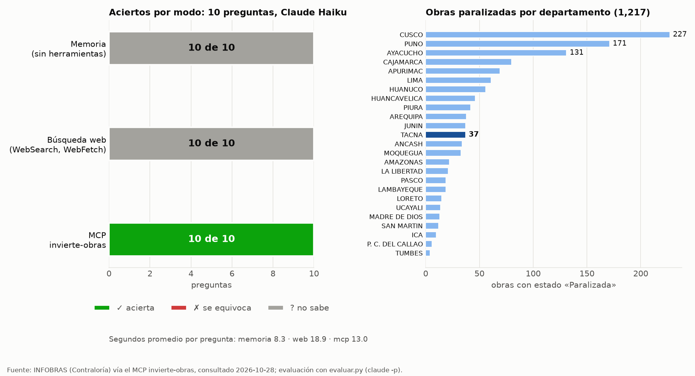

# Informe · Un MCP de inversiones y obras públicas del Perú

**Servidor:** `invierte-obras` (`server.py`), con datos en vivo de Invierte.pe (MEF) e INFOBRAS (Contraloría).
**Evaluación:** 28 de octubre de 2026, `uv run evaluar.py`, con Claude Haiku en modo no interactivo (`claude -p`).

| Pieza | Qué es |
|---|---|
| Herramientas | `contar_obras_por_departamento`, `listar_obras_infobras`, `buscar_inversiones`, `detalle_inversion` y la propia, `resumen_obras_departamento` |
| Herramienta propia | `resumen_obras_departamento(departamento, estado)`: recorre todas las páginas de INFOBRAS y devuelve el número de obras, el monto total y promedio, la obra de mayor monto y el reparto por provincia, entidad, modalidad y año. Las cuentas las hace Python, no el modelo |
| Recursos (`@`) | `invierte://inversion/{cui}` (ficha SSI de una inversión) e `infobras://paralizadas/por-departamento` |
| Prompt (`/`) | `informe_obras(departamento)`: informe de obras paralizadas que cruza INFOBRAS con Invierte.pe |
| Pruebas | `test_server.py`: 8 de 8 en verde (`uv run pytest -q`) |

## Resultados

Diez preguntas con una cifra oficial y una tolerancia (`preguntas.csv`), en tres modos: **memoria** (sin herramientas),
**web** (WebSearch y WebFetch) y **mcp** (solo las herramientas de `invierte-obras`).

| Modo | Acierta | Se equivoca | No sabe | Segundos promedio |
|---|---|---|---|---|
| Memoria | 0 | 0 | 10 | 8.3 |
| Web | 0 | 0 | 10 | 18.9 |
| MCP | **10** | 0 | 0 | 13.0 |

Fuente: `resultados.csv` (la corrida con los tres modos, que también es el experimento extra). La corrida base, solo memoria
contra MCP, está en `resultados_base.csv` y dio lo mismo: memoria 0 de 10 (10 «no sé», 10.4 s) y MCP 10 de 10 (16.1 s).

## Qué falló cada modo y por qué

- **Memoria, 10 «no sé».** Las diez preguntas piden datos vivos (conteos al 28/10/2026) o cifras de una ficha concreta
  (un CUI). Ninguna está en lo que el modelo aprendió. En la columna `fuente`, Haiku dice siempre que no tiene acceso a
  INFOBRAS ni a Invierte.pe, y **no inventó ninguna cifra**: la instrucción «si no puedes saberlo con certeza, pon null»
  funcionó.
- **Web, 10 «no sé» (experimento extra).** Es el resultado más interesante. Los portales de INFOBRAS y de la ficha SSI
  cargan los datos con JavaScript, así que WebFetch recibe una página vacía («el contenido es dinámico»). Además, Claude
  probó URL de Invierte.pe que no existen (HTTP 404) y la búsqueda solo trajo cifras de prensa de otras fechas y con otra
  metodología, por ejemplo 2,572 obras paralizadas según un diario o 49 en Tacna. Haiku las descartó porque no tenían la
  fecha de corte. Con las series del BCRP la web acertaba 7 de 8, porque esas cifras están publicadas en páginas
  estáticas. Aquí no.
- **MCP, 10 aciertos.** Cada respuesta usó una o dos llamadas (3 o 4 turnos): `contar_obras_por_departamento` o
  `resumen_obras_departamento` para INFOBRAS, y la ficha SSI de `detalle_inversion` para los CUI. La suma de los montos de Tacna
  (S/ 499,646,766.07, 37 obras) salió de la herramienta propia, sin sumas a mano. Es más lento que la memoria
  (13 s contra 8 s), pero es el único modo que responde.

Hay que tener en cuenta que los conteos de INFOBRAS cambian a diario: las verdades de `preguntas.csv` valen para el
28/10/2026, y por eso las tolerancias de los conteos nacionales son más amplias.

## Cifras del MCP comprobadas a mano en la web

Mis dos preguntas, `paralizadas_tacna` y `devengado_unanue`, las revisé a mano el 28/10/2026 en las páginas web
oficiales:

| Pregunta | Página web | Valor en la web | Respuesta del MCP | ¿Coincide? |
|---|---|---|---|---|
| `devengado_unanue`: devengado acumulado del CUI 2192844 | [Ficha SSI](https://ofi5.mef.gob.pe/ssi/Ssi/Index?codigo=2192844&tipo=2) | S/ 289,106,891.76 | S/ 289,106,891.76 | Sí, exacto |
| `paralizadas_tacna`: obras paralizadas en Tacna | [Mapa de INFOBRAS](https://infobras.contraloria.gob.pe/InfobrasWeb/Mapa/Index) | **36** | 37 | Difiere en 1 |

La diferencia en Tacna no es un error del MCP. A las 21:05, la API que usa el propio portal seguía devolviendo 37 obras,
tanto en el conteo por departamento como en el listado, donde aparecen las 37 con su código INFOBRAS. Es decir, el mapa
muestra una obra menos que el buscador del mismo sistema, probablemente porque solo dibuja las obras que tienen
ubicación registrada (el listado no trae coordenadas, así que no se puede confirmar). En `preguntas.csv` dejé como
verdad la cifra revisada a mano, **36**. La respuesta del MCP (37) queda dentro de la tolerancia de 1, así que se cuenta
como acierto, y los dos CSV de resultados se volvieron a calificar con `uv run evaluar.py --recalificar`. Para el monto
de Tacna, la verdad (S/ 499,646,766.07) sale de las 37 obras del listado.

En la misma ficha SSI coinciden también otras dos cifras de `detalle_inversion`: el costo de inversión actualizado,
«(a) 632,167,753.73», y los beneficiarios, «324,498».

La misma ficha explica una diferencia entre las dos fuentes de Invierte.pe. Para este CUI, el Banco de Inversiones
(`buscar_inversiones`) da un costo de S/ 633,486,449.64, que en la ficha es el **costo total** (a+b+c+d) e incluye
S/ 1,318,695.91 de costo de controversias. Por eso en `buscar_inversiones` ese campo se llama ahora
`costo_total_actualizado`, para que el modelo no mezcle las dos cifras. La ficha también confirma el registro de la Ley
31589: obra paralizada el 10/04/2024 por resolución de contrato.

## Conclusión

Vale la pena construir un MCP cuando el dato vive detrás de un portal dinámico o de una API sin documentar, como
INFOBRAS o la ficha SSI, cuando cambia a diario o cuando la respuesta exige cuentas sobre muchas páginas. En esos casos,
ni la memoria ni la búsqueda web llegan a la cifra: aquí sacaron 0 de 10, y el MCP 10 de 10. La búsqueda web basta
cuando la cifra ya está publicada en una página estática e indexada (una nota de prensa, un reporte en PDF o una tabla
del BCRP) y no hace falta que sea del día. Además, el MCP deja trazabilidad, porque cada respuesta cita la herramienta,
la fuente y la hora de consulta.
